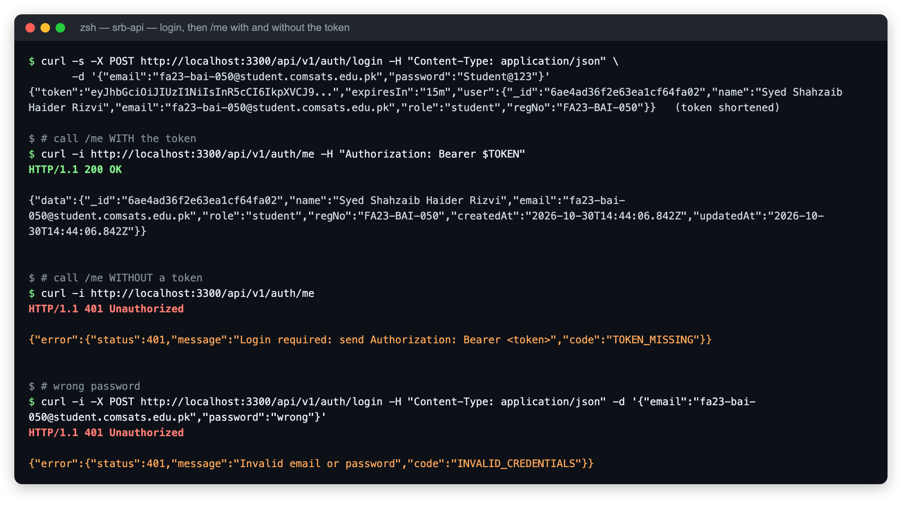
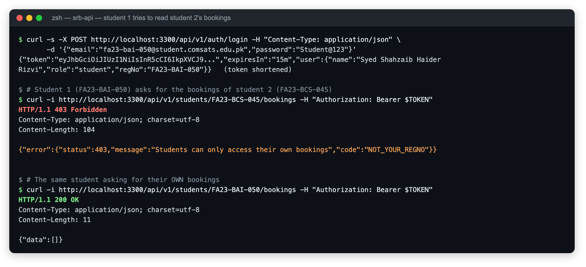
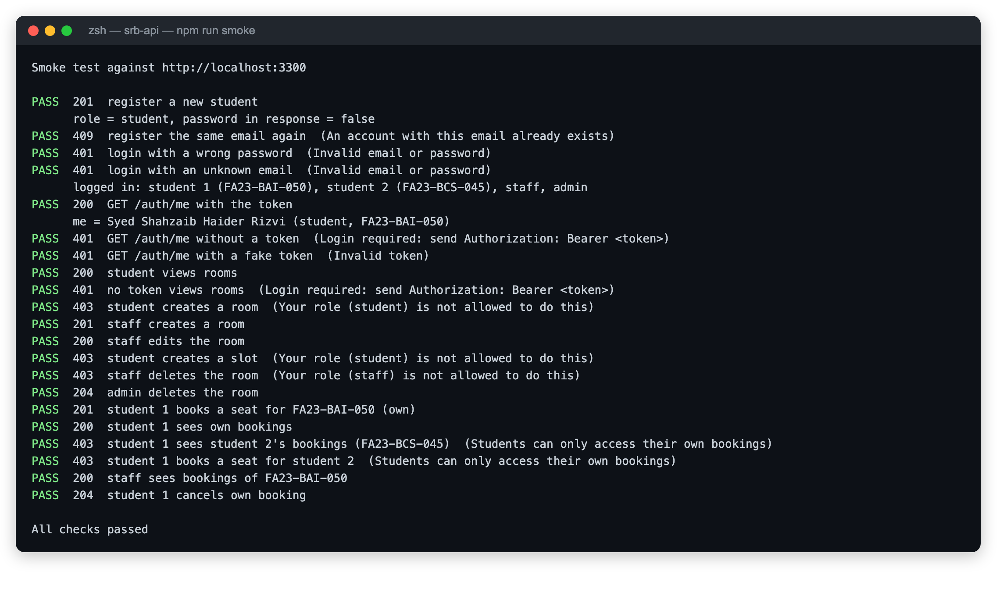

# srb-api — Study Room Booking Service

CSC337 Advanced Web Technologies, Assignment 1 + Assignment 2 (authentication and roles)

**Student:** Syed Shahzaib Haider Rizvi  **Roll no:** FA23-BAI-050

This is the backend of a study room booking system. Each room has two-hour time slots, and a student can book a seat in a slot. It is built with Node.js, Express 5 and MongoDB (Mongoose). It offers a REST API under `/api/v1`, GraphQL (Apollo Server) at `/graphql`, and Socket.IO for live room boards.

---

## Running the project

```bash
npm install
cp .env.example .env        # then edit the values
```

`.env`:

| Variable | Meaning |
|---|---|
| `PORT` | HTTP port (default 3000) |
| `MONGODB_URI` | MongoDB connection string, e.g. `mongodb://127.0.0.1:27017/srb` |
| `ADMIN_KEY` | key the `/admin` Socket.IO namespace requires |
| `JWT_SECRET` | secret used to sign login tokens (Assignment 2) |
| `ADMIN_EMAIL`, `ADMIN_PASSWORD` | the admin account created by `npm run seed:admin` |

**Option A: with your own MongoDB**

```bash
npm run seed      # sample data: 4 rooms, 14 slots, 3 students + login accounts
npm run seed:admin   # only the admin account (already included in npm run seed)
npm start         # or: npm run dev (restarts on file changes)
npm run smoke     # in a 2nd terminal: logs in and tests the auth + role rules
```

**Option B: no MongoDB installed**

```bash
npm run dev:memory
```

This starts an in-memory MongoDB, seeds it and runs the API. All data is lost when the process stops.

Then open:

| URL | What it is |
|---|---|
| http://localhost:3000/health | `{ "status": "ok" }` |
| http://localhost:3000/api/v1/rooms | REST API |
| http://localhost:3000/graphql | GraphQL (Apollo Sandbox in the browser) |
| http://localhost:3000/board.html?room=ROOM-01 | live room board |
| http://localhost:3000/admin.html | admin console for announcements |

---

# Assignment 2: Authentication and Authorization

## Question 1: register and log in with JWT

| Method | URL | Result |
|---|---|---|
| POST | `/api/v1/auth/register` `{ name, email, password, regNo }` | `201` the new user (always role **student**, never the password); `409` if the email or regNo already exists |
| POST | `/api/v1/auth/login` `{ email, password }` | `200 { token, expiresIn: "15m", user }`; `401` for a wrong password or unknown email |
| GET | `/api/v1/auth/me` | `200` the logged-in user; `401` without a valid token |

- **User model** (`src/models/User.js`) has name, email, password, role (`student`, `staff`, `admin`) and regNo. The password is hashed with **bcrypt** before saving. `select: false` and `toJSON` keep the hash out of every response.
- **Registration** always creates a `student`. A `role` field sent by the client is ignored. A matching Student record is created too, so the Assignment 1 booking code works unchanged.
- **The admin** is created by `scripts/seed-admin.js` (`npm run seed:admin`) from `ADMIN_EMAIL` / `ADMIN_PASSWORD` in `.env`.
- **The JWT** holds only the user id (`sub`) and `role`, and expires after **15 minutes**. It is signed with `JWT_SECRET` from `.env`.
- **`requireAuth`** (`src/middleware/requireAuth.js`) reads `Authorization: Bearer <token>`. A missing, invalid or expired token gives **401** (`TOKEN_MISSING`, `TOKEN_INVALID`, `TOKEN_EXPIRED`).

**Check — log in, call `/me` with the token (200), then without a token (401):**



**Demo accounts** (created by `npm run seed`):

| Account | Email | Password |
|---|---|---|
| Student 1 | fa23-bai-050@student.comsats.edu.pk (FA23-BAI-050) | Student@123 |
| Student 2 | ayesha.khan@student.comsats.edu.pk (FA23-BCS-045) | Student@123 |
| Staff | staff@srb.edu.pk | Staff@1234 |
| Admin | value of `ADMIN_EMAIL` | value of `ADMIN_PASSWORD` |

**Why we hash passwords.** If the database is ever leaked or read by someone who shouldn't see it, hashed passwords cannot simply be read and reused. Many people reuse the same password on other sites. bcrypt is slow on purpose and adds a random salt to every password, so guessing passwords from a stolen hash is very expensive. The server only ever compares hashes, so even the developers never know a user's real password.

**Why a JWT must not contain the password.** A JWT is only *signed*, not *encrypted*: anyone who has the token can decode it (it is base64) and read everything inside. Tokens end up in browser storage, logs and proxies. A password inside would be exposed to all of them. The token only needs to say *who* the user is (id) and *what they may do* (role).

## Question 2: role-based access

All rules live in **one file**, `src/config/roles.js`. The `authorize` middleware runs after `requireAuth`: `allow(action)` checks the role, and `allowOwnRegNo` checks the regNo.

| Action | student | staff | admin |
|---|---|---|---|
| View rooms and slots | yes | yes | yes |
| Create or edit rooms and slots | no (403) | yes | yes |
| Delete a room | no (403) | no (403) | yes |
| Book or cancel a seat, see bookings | only for own regNo | any student | any student |

- **No token → 401. Logged in but not allowed → 403.**
- **Booking logic unchanged:** the Assignment 1 booking service is the same; only the checks in front of the routes are new.
- **GraphQL:** the `/graphql` resolvers apply the same rules (they read the Bearer token from the request), so the REST rules cannot be bypassed through GraphQL. `/health` and the static board pages stay public.
- **`scripts/smoke.js` (`npm run smoke`)** logs in as two students, staff and admin, then tests every rule. All 21 checks pass.
- **Postman:** run the folder `0. Auth` first. It saves `adminToken` and `studentToken`, and the other requests then use the admin token. All 62 requests / 123 assertions pass.

**Check — student 1 (FA23-BAI-050) trying to see student 2's (FA23-BCS-045) bookings gets 403:**





**What could go wrong if we only checked the login and not the regNo.** Any logged-in student could change the regNo in the URL. They could then read other students' bookings (a privacy leak), cancel other students' seats, or book seats in someone else's name. This is called *Broken Object Level Authorization* (IDOR), the #1 risk in the OWASP API Top 10. Logging in proves *who* you are. Only the regNo check proves the data is *yours*.

---

# Assignment 1

## Question 1: project structure

```
srb-api/
├── src/
│   ├── app.js              # builds the Express app (middleware, routes, 404, error handler)
│   ├── server.js           # connects MongoDB, creates the HTTP server, attaches Socket.IO, listens
│   ├── config/             # env.js (reads .env), db.js (Mongoose connection)
│   ├── routes/             # URL -> controller mapping
│   ├── controllers/        # HTTP layer: read req, call a service, send status + JSON
│   ├── services/           # business rules (shared by REST, GraphQL and Socket.IO)
│   ├── models/             # Mongoose schemas: Room, Slot, Student, Booking
│   ├── middleware/         # logger, notFound, errorHandler, requireFields, validateObjectId
│   ├── graphql/            # typeDefs, resolvers, Apollo setup
│   ├── realtime/           # Socket.IO server (boards + /admin namespace)
│   └── utils/ApiError.js
├── public/                 # board.html, admin.html
├── scripts/                # seed.js, dev-memory.js
├── docs/                   # draw.io diagrams
├── postman/                # Postman collection
└── dashboard.graphql
```

- **Settings:** `PORT`, `MONGODB_URI` and `ADMIN_KEY` come from `.env`. `.env` is git-ignored, and `.env.example` is committed in its place.
- **Request logging:** every request is printed after its response is sent, as method, URL, status code and time taken, e.g. `POST /api/v1/students/FA23-BAI-050/bookings 201 12.4 ms`.
- **Errors:** every error comes back in the same JSON shape, from the 404 handler, the error handler, validation, duplicate keys and malformed JSON alike:
  ```json
  { "error": { "status": 404, "message": "Route not found" } }
  { "error": { "status": 409, "message": "No free seat in this slot", "code": "SLOT_FULL" } }
  ```

## Question 2: diagrams

`docs/srb-architecture.drawio` has three pages:
1. Deployment diagram
2. ER diagram
3. Sequence diagram of booking a slot, including the "slot full" case

Open it in draw.io or https://app.diagrams.net.

## Question 3: REST API (`/api/v1`)

| Method | Path | Success | Errors |
|---|---|---|---|
| GET | `/rooms` | 200 | |
| GET | `/rooms/:roomCode` | 200 | 404 |
| POST | `/rooms` | 201 | 400 missing field, 409 duplicate, 422 invalid value |
| PUT | `/rooms/:roomCode` | 200 | 400, 404, 422 (incl. `ROOMCODE_IMMUTABLE`) |
| PATCH | `/rooms/:roomCode` | 200 | 400, 404, 422 `ROOMCODE_IMMUTABLE` |
| DELETE | `/rooms/:roomCode` | 204 | 404, 409 `ROOM_HAS_BOOKINGS` |
| POST | `/slots` | 201 | 400, 404 room not found, 409 duplicate slot, 422 (e.g. `startHour: 9`) |
| GET | `/slots/:id` | 200 | 400 bad id, 404 |
| GET | `/slots?roomCode=&date=&hasSeats=true&page=&limit=` | 200 | 400 bad page/limit |
| POST | `/students` | 201 | 400, 409, 422 bad regNo/email |
| GET | `/students/:regNo` | 200 | 404 |
| POST | `/students/:regNo/bookings` `{ "slotId": "..." }` | 201 | 400, 404, 409 `SLOT_FULL`, 409 `ALREADY_BOOKED` |
| GET | `/students/:regNo/bookings` | 200 | 404 |
| DELETE | `/students/:regNo/bookings/:slotId` | 204 | 400, 404 |

**Data rules**
- **400 vs 422:** a missing body or field, malformed JSON or a malformed id is **400**. A field that is present but has an invalid value is **422** (the Mongoose validation error).
- **Slot seats:** a slot's `seats` value is copied from its room when the slot is created. `booked` starts at 0.
- **Slot list response:** `GET /slots` returns `{ data, page, limit, total, totalPages }`. `hasSeats=true` uses `$expr: { $lt: ['$booked', '$seats'] }`.

**Booking rules** (`src/services/bookings.service.js`)
1. If the student or the slot does not exist, the API returns 404.
2. If this student already has this slot, it returns 409 `ALREADY_BOOKED`. A unique index on `(regNo, slot)` also enforces this.
3. The seat is taken with **one atomic `findOneAndUpdate`**:
   ```js
   Slot.findOneAndUpdate(
     { _id: slotId, $expr: { $lt: ['$booked', '$seats'] } },
     { $inc: { booked: 1 } },
     { returnDocument: 'after' }
   );
   ```
   If this returns `null` there was no free seat, and the API returns 409 `SLOT_FULL`. MongoDB applies the condition and the increment as one operation, so two students can never both get the last seat. In testing, 8 simultaneous requests for a 2-seat slot gave exactly 2 × 201 and 6 × 409.

**Sample data:** `npm run seed` loads 4 rooms (ROOM-01 to ROOM-04), 14 slots and 3 students, including FA23-BAI-050.

**Postman:** import `postman/srb-api.postman_collection.json`. It has 52 requests in folders, covering success and failure cases, with a test script on each. Run it top to bottom in the Collection Runner on freshly seeded data. All 111 assertions pass.

## Question 4: GraphQL (`POST /graphql`)

- **Queries:** `rooms`, `slots(roomCode, date)`, `student(regNo)`. A `Student` has `bookings`, and each booking has `roomName`, `date` and `startHour`.
- **Mutations:** `bookSlot(regNo, slotId)` and `cancelBooking(regNo, slotId)`. The resolvers in `src/graphql/resolvers.js` contain no business logic. They call the same `bookingsService.bookSlot` and `cancelBooking` functions as the REST controllers, so the rules, the atomic seat update and the Socket.IO update all happen in one place. Service errors keep their code, e.g. `extensions.code: "SLOT_FULL"`.

**`dashboard.graphql`** gets a student and all of their bookings in one request:

```graphql
query StudentDashboard($regNo: String! = "FA23-BAI-050") {
  student(regNo: $regNo) {
    regNo name email
    bookings { slotId roomCode roomName date startHour bookedAt }
  }
}
```

**Advantage over REST:** with REST, the dashboard needs at least two round trips: `GET /students/:regNo` and `GET /students/:regNo/bookings`. A client that only has slot ids would also need one `GET /slots/:id` plus one room lookup per booking (the N+1 problem). Each REST response also carries fields the screen doesn't use (over-fetching). The GraphQL query fetches exactly the fields the dashboard shows, nested the way the screen uses them, in **one request**. That means less latency on mobile networks, and the client decides its data needs without new endpoints on the server.

## Question 5: real-time with Socket.IO

Booking is still done through REST (or GraphQL). Socket.IO only pushes the changes.

- **Opening a board:** `board.html?room=ROOM-01` emits `join:room` with the roomCode. The acknowledgement returns the room and its current slots. The server puts the socket in a Socket.IO room named after the roomCode.
- **Live updates:** after a booking is made or cancelled, the service calls `io.to(roomCode).emit('slot:updated', { slotId, seatsLeft })`. Only boards for that room receive it.
- **Admin:** the `/admin` namespace checks `auth.adminKey` against `ADMIN_KEY` in middleware. A wrong key gets the connect_error **"Invalid admin key: connection refused"**. An admin emits `announce` with a message, and every connected board shows it (`admin.html`).
- **Connection status:** the board shows connected, disconnected or reconnecting. It re-joins the room and reloads the snapshot in its `connect` handler, which runs after every automatic reconnect, so after a server restart it shows the correct seats without a page refresh.
- **No HTML injection:** all user text (room names, announcements) is shown with `textContent`, never `innerHTML`.

**Acceptance test:**
1. Open two boards for ROOM-01 and one for ROOM-02.
2. In Postman, book a ROOM-01 slot.
3. Both ROOM-01 boards update within a second. In testing this took about 30 ms, and the ROOM-02 board received nothing.
